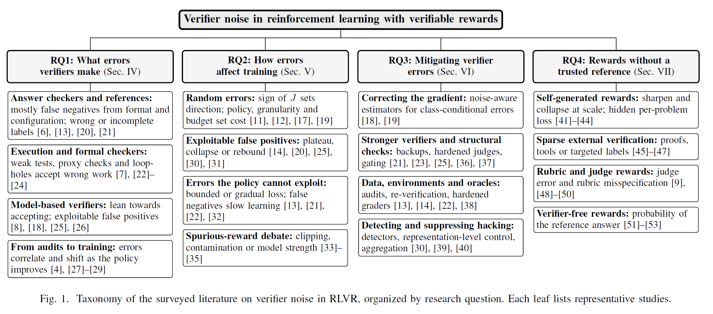
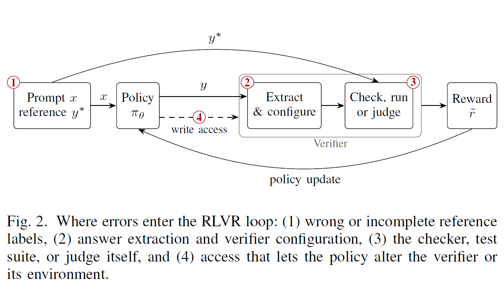

# Checking the Checkers: A Synthesis of Verifier Noise and Robustness in RLVR

**Savyasachi Gupta** and **Aniruddha Srinivas Joshi**

*Accepted at the International Conference on Artificial Intelligence Centric Systems, Services, and Applications (AISSA 2026), San Antonio, Texas, USA.*

This repository accompanies our survey of 58 studies that measure, analyze, or mitigate verifier errors in reinforcement learning with verifiable rewards (RLVR). It lists every work cited in the paper, with links, organized by the paper's four research questions.

## Citation

> **TODO:** replace this entry with the final citation once the proceedings details are available.

```bibtex
@inproceedings{gupta2026checking,
  title     = {Checking the Checkers: A Synthesis of Verifier Noise and Robustness in {RLVR}},
  author    = {Gupta, Savyasachi and Joshi, Aniruddha Srinivas},
  booktitle = {International Conference on Artificial Intelligence Centric Systems, Services, and Applications (AISSA)},
  year      = {2026},
  note      = {To appear}
}
```

**Preprint:** TODO: add arXiv link

## Taxonomy

<p align="center">
  
</p>

*Taxonomy of the surveyed literature on verifier noise in RLVR, organized by research question. Each leaf lists representative studies; the bracketed numbers are the paper's reference numbers and match the **Ref** column in the tables below.*

## Main findings of the survey

* **The structure of an error matters more than its rate.** Random errors mostly slow learning. Under a fixed budget or a KL penalty they also lower final accuracy. False positives that the policy can learn to trigger lead to plateaus or collapse, sometimes even at low initial error rates.
* **Error direction depends on what the checker checks and who built it, not on the verifier family.** Verifier errors also shift as the policy improves, so accuracy measured before training says little about robustness during it.
* **Most mitigations have been tested against a single kind of error.** Self-generated rewards stay bounded by the model's prior unless some external verification is added.
* **The evidence base is narrow.** Nearly all training studies use Qwen models, trained policies rarely exceed 32B parameters, and most tasks are mathematical. The paper proposes a reporting protocol to make future results comparable.

<p align="center">
  
</p>

*Where errors enter the RLVR loop: (1) wrong or incomplete reference labels, (2) answer extraction and verifier configuration, (3) the checker, test suite, or judge itself, and (4) access that lets the policy alter the verifier or its environment.*

## Surveyed studies (58)

**Ref** is the reference number used in the paper. A study that the paper discusses under more than one research question is listed once, under the first one in which it appears. Links point to open-access versions where available; see the paper's reference list for the venue of record.

### RQ1: What errors verifiers make

*What errors do the verifiers used in RLVR make, where do these errors come from, and how often do they occur?*

| S.No | Ref | Paper |
|:---:|:---:|---|
| 1 | [6] | [Where the Verifier Fails: A Category-Level Audit of Reward Signals in RLVR](https://arxiv.org/abs/2609.01354) |
| 2 | [7] | [Auditing Reward Hackability in Code RL Training Environments](https://arxiv.org/abs/2606.16062) |
| 3 | [8] | [One Token to Fool LLM-as-a-Judge](https://arxiv.org/abs/2507.08794) |
| 4 | [13] | [Noisy Data is Destructive to Reinforcement Learning with Verifiable Rewards](https://arxiv.org/abs/2603.16140) |
| 5 | [18] | [Reinforcement Learning with Verifiable yet Noisy Rewards under Imperfect Verifiers](https://arxiv.org/abs/2510.00915) |
| 6 | [20] | [From Accuracy to Robustness: A Study of Rule- and Model-Based Verifiers in Mathematical Reasoning](https://arxiv.org/abs/2505.22203) |
| 7 | [21] | [TinyV: Reducing False Negatives in Verification Improves RL for LLM Reasoning](https://arxiv.org/abs/2505.14625) |
| 8 | [22] | [When the Reward Suite is Leaky: A Preregistered Causal Contrast of Natural Verifier False Positives in RLVR](https://arxiv.org/abs/2607.11022) |
| 9 | [23] | [LLMs Gaming Verifiers: RLVR Can Lead to Reward Hacking](https://arxiv.org/abs/2604.15149) |
| 10 | [24] | [Faults in Our Formal Benchmarking: Dataset Defects and Evaluation Failures in Lean Theorem Proving](https://arxiv.org/abs/2606.29493) |
| 11 | [25] | [AdvJudge-Zero: Binary Decision Flips in LLM-as-a-Judge via Adversarial Control Tokens](https://arxiv.org/abs/2512.17375) |
| 12 | [26] | [Reward Under Attack: Analyzing the Robustness and Hackability of Process Reward Models](https://arxiv.org/abs/2603.06621) |
| 13 | [27] | [Are Verifier Errors Independent within a GRPO Group? Evidence from Qwen2.5 Rollouts](https://arxiv.org/abs/2609.06386) |
| 14 | [28] | [Nine Judges, Two Effective Votes: Correlated Errors Undermine LLM Evaluation Panels](https://arxiv.org/abs/2605.29800) |
| 15 | [29] | [Variation in Verification: Understanding Verification Dynamics in Large Language Models](https://arxiv.org/abs/2509.17995) |
| 16 | [61] | [CompassVerifier: A Unified and Robust Verifier for LLMs Evaluation and Outcome Reward](https://arxiv.org/abs/2508.03686) |
| 17 | [67] | [VerifyBench: A Systematic Benchmark for Evaluating Reasoning Verifiers Across Domains](https://arxiv.org/abs/2507.09884) |
| 18 | [69] | [ROC-n-reroll: How Verifier Imperfection Affects Test-Time Scaling](https://arxiv.org/abs/2507.12399) |

### RQ2: How errors affect training

*How do verifier errors affect RLVR training, and what determines whether their effect is benign or harmful?*

| S.No | Ref | Paper |
|:---:|:---:|---|
| 19 | [11] | [An Imperfect Verifier is Good Enough: Learning with Noisy Rewards](https://arxiv.org/abs/2604.07666) |
| 20 | [12] | [The Climb Carves Wisdom Deeper Than the Summit: On the Noisy Rewards in Learning to Reason](https://arxiv.org/abs/2505.22653) |
| 21 | [14] | [Delay, Plateau, or Collapse: Evaluating the Impact of Systematic Verification Error on RLVR](https://arxiv.org/abs/2605.02909) |
| 22 | [17] | [Rate or Fate? RLV<sup>ε</sup>R: Reinforcement Learning with Verifiable Noisy Rewards](https://arxiv.org/abs/2601.04411) |
| 23 | [19] | [Noise-Corrected GRPO: From Noisy Rewards to Unbiased Gradients](https://arxiv.org/abs/2510.18924) |
| 24 | [30] | [From Rebound to Remedy: Understanding and Mitigating Reward Hacking via Representation Engineering](https://arxiv.org/abs/2604.01476) |
| 25 | [31] | [Countdown-Code: A Testbed for Studying the Emergence and Generalization of Reward Hacking in RLVR](https://arxiv.org/abs/2603.07084) |
| 26 | [32] | [VerifyBench: Benchmarking Reference-Based Reward Systems for Large Language Models](https://arxiv.org/abs/2505.15801) |
| 27 | [33] | [Spurious Rewards: Rethinking Training Signals in RLVR](https://arxiv.org/abs/2506.10947) |
| 28 | [34] | [Reasoning or Memorization? Unreliable Results of Reinforcement Learning Due to Data Contamination](https://arxiv.org/abs/2507.10532) |
| 29 | [35] | [Exploration vs. Exploitation: Rethinking RLVR through Clipping, Entropy, and Spurious Reward](https://arxiv.org/abs/2512.16912) |
| 30 | [70] | [From Exploration to Exploitation: A Two-Stage Entropy RLVR Approach for Noise-Tolerant MLLM Training](https://arxiv.org/abs/2511.07738) |

### RQ3: Mitigating verifier errors

*Which methods make RLVR robust to verifier errors, what do they cost, and against which kinds of error have they been shown to work?*

| S.No | Ref | Paper |
|:---:|:---:|---|
| 31 | [36] | [xVerify: Efficient Answer Verifier for Reasoning Model Evaluations](https://arxiv.org/abs/2504.10481) |
| 32 | [37] | [VeriGate: Verifier-Gated Step-Level Supervision for GRPO](https://arxiv.org/abs/2605.30451) |
| 33 | [38] | [Reward Hacking Benchmark: Measuring Exploits in LLM Agents with Tool Use](https://arxiv.org/abs/2605.02964) |
| 34 | [39] | [Benchmarking Reward Hack Detection in Code Environments via Contrastive Analysis](https://arxiv.org/abs/2601.20103) |
| 35 | [40] | [CARE: Confounder-Aware Aggregation for Reliable LLM Evaluation](https://arxiv.org/abs/2603.00039) |

### RQ4: Rewards without a trusted reference

*How do these findings carry over to rewards that lack a trusted reference answer or a checker, namely self-generated, rubric- and judge-based, and verifier-free rewards?*

| S.No | Ref | Paper |
|:---:|:---:|---|
| 36 | [9] | [Reward Hacking in Rubric-Based Reinforcement Learning](https://arxiv.org/abs/2605.12474) |
| 37 | [10] | [RubricEval: A Rubric-Level Meta-Evaluation Benchmark for LLM Judges in Instruction Following](https://arxiv.org/abs/2603.25133) |
| 38 | [41] | [TTRL: Test-Time Reinforcement Learning](https://arxiv.org/abs/2504.16084) |
| 39 | [42] | [How Far Can Unsupervised RLVR Scale LLM Training?](https://proceedings.iclr.cc/paper_files/paper/2026/hash/18929f3253e4d4e28086a89ab88d1276-Abstract-Conference.html) |
| 40 | [43] | [Detecting and Mitigating the Correct-Answer Extinction Window in Test-Time Reinforcement Learning with Majority Voting](https://arxiv.org/abs/2605.19444) |
| 41 | [44] | [Don't Peek at the Answer: Outcome-Masked Group Relative Policy Optimization for Label-Free RLVR](https://arxiv.org/abs/2608.03119) |
| 42 | [45] | [JURY-RL: Votes Propose, Proofs Dispose for Label-Free RLVR](https://arxiv.org/abs/2604.25419) |
| 43 | [46] | [Tool Verification for Test-Time Reinforcement Learning](https://arxiv.org/abs/2603.02203) |
| 44 | [47] | [When Self-Belief Misleads: Active Label Acquisition for Reinforcement Learning with Verifiable Rewards](https://arxiv.org/abs/2605.25864) |
| 45 | [48] | [Rubrics as Rewards: Reinforcement Learning beyond Verifiable Domains](https://arxiv.org/abs/2507.17746) |
| 46 | [49] | [Reproducing, Analyzing, and Detecting Reward Hacking in Rubric-Based Reinforcement Learning](https://arxiv.org/abs/2606.04923) |
| 47 | [50] | [Examining Reasoning LLMs-as-Judges in Non-Verifiable LLM Post-Training](https://arxiv.org/abs/2603.12246) |
| 48 | [51] | [Reinforcing General Reasoning without Verifiers](https://arxiv.org/abs/2505.21493) |
| 49 | [52] | [RLPR: Extrapolating RLVR to General Domains without Verifiers](https://arxiv.org/abs/2506.18254) |
| 50 | [53] | [DARL: Encouraging Diverse Answers for General Reasoning without Verifiers](https://arxiv.org/abs/2601.14700) |
| 51 | [73] | [RESTRAIN: From Spurious Votes to Signals—Self-Training RL with Self-Penalization](https://arxiv.org/abs/2510.02172) |
| 52 | [74] | [Co-Rewarding: Stable Self-Supervised RL for Eliciting Reasoning in Large Language Models](https://proceedings.iclr.cc/paper_files/paper/2026/hash/8587c39571f3e327725e2812749a9389-Abstract-Conference.html) |
| 53 | [75] | [Label-Free Steering: Compressing Test-Time Reinforcement Learning into Bias-Only Subspaces](https://arxiv.org/abs/2609.18587) |
| 54 | [76] | [Learning to Reason without External Rewards](https://arxiv.org/abs/2505.19590) |
| 55 | [77] | [Dual Consensus: Escaping from Spurious Majority in Unsupervised RLVR via Two-Stage Vote Mechanism](https://arxiv.org/abs/2603.16223) |
| 56 | [78] | [SPINE: Token-Selective Test-Time Reinforcement Learning with Entropy-Band Regularization](https://arxiv.org/abs/2511.17938) |
| 57 | [79] | [Breaking the Exploration Bottleneck: Rubric-Scaffolded Reinforcement Learning for Open-Ended LLM Reasoning](https://openreview.net/forum?id=5doZa7g4XL) |
| 58 | [80] | [Checklists Are Better Than Reward Models for Aligning Language Models](https://proceedings.neurips.cc/paper_files/paper/2025/hash/a6837c1dd021f76f1b4098e3722052a8-Abstract-Conference.html) |

## Related surveys (3)

| S.No | Ref | Paper |
|:---:|:---:|---|
| 59 | [5] | [A Technical Survey of Reinforcement Learning Techniques for Large Language Models](https://arxiv.org/abs/2507.04136) |
| 60 | [15] | [Reward Hacking in the Era of Large Models: Mechanisms, Emergent Misalignment, Challenges](https://arxiv.org/abs/2604.13602) |
| 61 | [16] | [A Survey on LLM-as-a-Judge](https://doi.org/10.1016/j.xinn.2025.101253) |

## Other cited works (20)

Works cited as background only.

| S.No | Ref | Paper |
|:---:|:---:|---|
| 62 | [1] | [Tülu 3: Pushing Frontiers in Open Language Model Post-Training](https://openreview.net/forum?id=i1uGbfHHpH) |
| 63 | [2] | [DeepSeek-R1 Incentivizes Reasoning in LLMs through Reinforcement Learning](https://www.nature.com/articles/s41586-025-09422-z) |
| 64 | [3] | [DeepSeekMath: Pushing the Limits of Mathematical Reasoning in Open Language Models](https://arxiv.org/abs/2402.03300) |
| 65 | [4] | [Process Reinforcement through Implicit Rewards](https://arxiv.org/abs/2502.01456) |
| 66 | [54] | [Understanding R1-Zero-Like Training: A Critical Perspective](https://openreview.net/forum?id=5PAF7PAY2Y) |
| 67 | [55] | [DAPO: An Open-Source LLM Reinforcement Learning System at Scale](https://proceedings.neurips.cc/paper_files/paper/2025/hash/a4277440d50f1f15d2cb4c14f7e0c0d2-Abstract-Conference.html) |
| 68 | [56] | [Gradient Starvation in Binary-Reward GRPO: Why Group-Mean Centering Fails and Why the Simplest Fix Works](https://arxiv.org/abs/2605.07689) |
| 69 | [57] | [Your Group-Relative Advantage is Biased](https://arxiv.org/abs/2601.08521) |
| 70 | [58] | [AceReason-Nemotron 1.1: Advancing Math and Code Reasoning through SFT and RL Synergy](https://arxiv.org/abs/2506.13284) |
| 71 | [59] | [Reinforcement Learning with Verifiable Rewards: GRPO's Loss, Dynamics, and Success Amplification](https://arxiv.org/abs/2503.06639) |
| 72 | [60] | [Is Your Code Generated by ChatGPT Really Correct? Rigorous Evaluation of Large Language Models for Code Generation](https://arxiv.org/abs/2305.01210) |
| 73 | [62] | [Let's Verify Step by Step](https://proceedings.iclr.cc/paper_files/paper/2024/hash/aca97732e30bcf1303bc22ac3924fd16-Abstract-Conference.html) |
| 74 | [63] | [Reinforcement Learning with Perturbed Rewards](https://doi.org/10.1609/aaai.v34i04.6086) |
| 75 | [64] | [Reinforcement Learning with a Corrupted Reward Channel](https://dl.acm.org/doi/abs/10.5555/3171837.3171946) |
| 76 | [65] | [Defining and Characterizing Reward Gaming](https://proceedings.neurips.cc/paper_files/paper/2022/hash/3d719fee332caa23d5038b8a90e81796-Abstract-Conference.html) |
| 77 | [66] | [Scaling Laws for Reward Model Overoptimization](https://proceedings.mlr.press/v202/gao23h.html) |
| 78 | [68] | [Is LLM-as-a-Judge Robust? Investigating Universal Adversarial Attacks on Zero-Shot LLM Assessment](https://arxiv.org/abs/2402.14016) |
| 79 | [71] | [Reasoning Gym: Reasoning Environments for Reinforcement Learning with Verifiable Rewards](https://proceedings.neurips.cc/paper_files/paper/2025/hash/528d56195a2c77c808494c86fa7c77ad-Abstract-Datasets_and_Benchmarks_Track.html) |
| 80 | [72] | [Monitoring Emergent Reward Hacking During Generation via Internal Activations](https://arxiv.org/abs/2603.04069) |
| 81 | [81] | [Evaluating Feature Dependent Noise in Preference-Based Reinforcement Learning](https://arxiv.org/abs/2601.01904) |

## Contact

Savyasachi Gupta ([@gsavya10](https://github.com/gsavya10), [gsavya10@gmail.com](mailto:gsavya10@gmail.com)). For anything about the data, please [open an issue](https://github.com/reasoning-ai-lab/Checking-the-Checkers-RLVR/issues).

## License

This work is licensed under a [Creative Commons Attribution 4.0 International License (CC BY 4.0)](https://creativecommons.org/licenses/by/4.0/).
